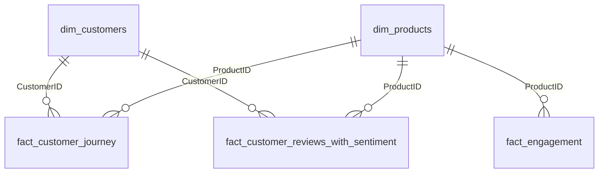
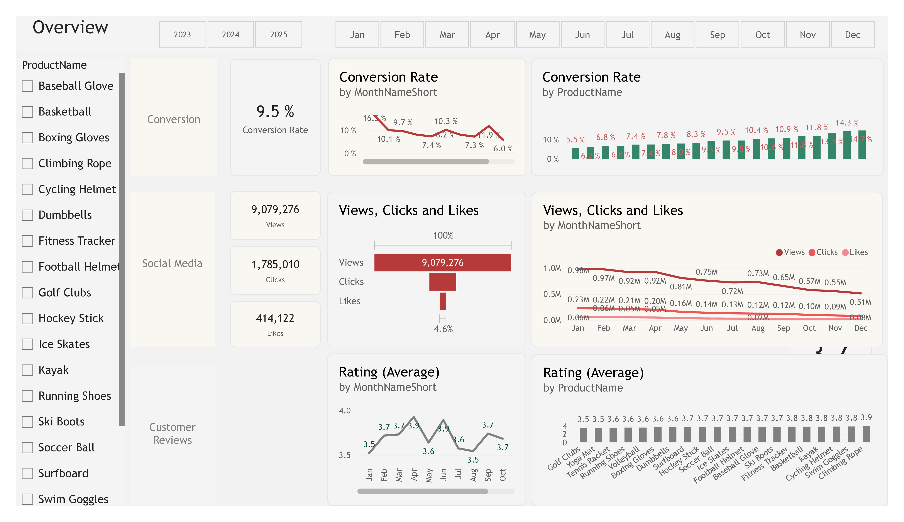
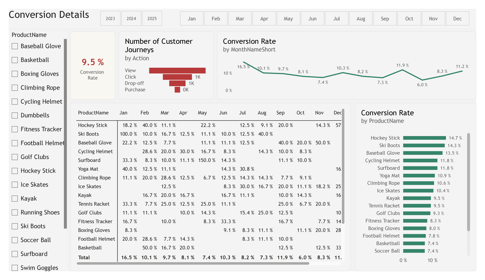
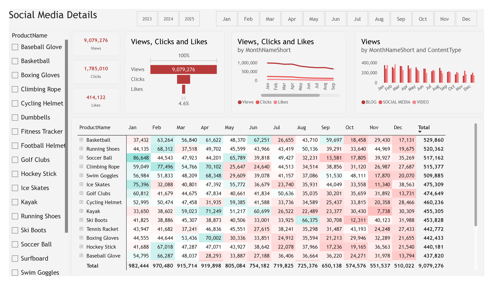
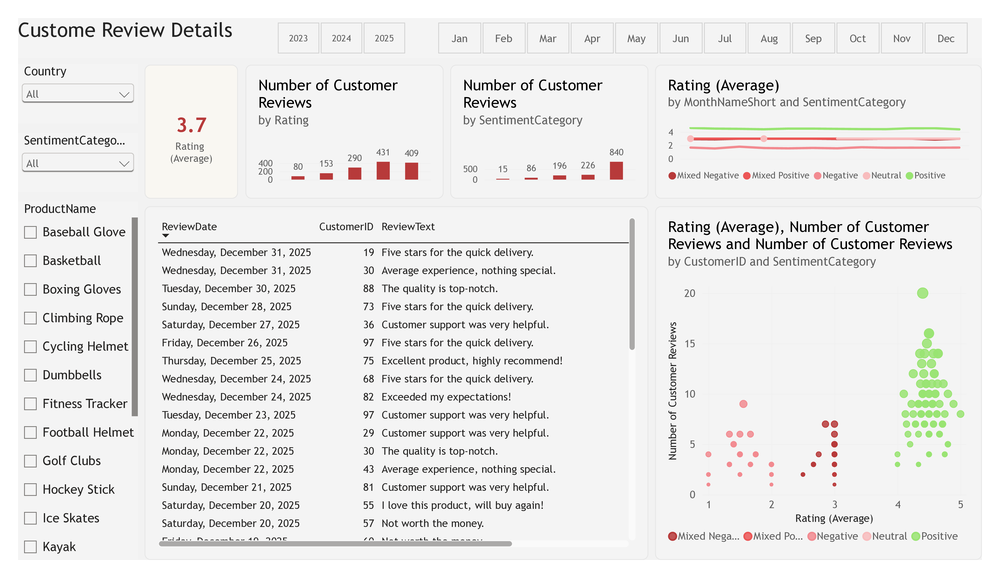

# ShopEasy Marketing Analytics: Conversion, Engagement, and Customer Sentiment Dashboard (Power BI)

> End-to-end marketing analytics project: business case, data model, interactive dashboard, and presentation of recommendations.


---

## Table of Contents

1. [Business Problem](#1-business-problem)
2. [Objectives and KPIs](#2-objectives-and-kpis)
3. [Dataset and Data Model](#3-dataset-and-data-model)
4. [Methodology](#4-methodology)
5. [Dashboard Overview](#5-dashboard-overview)
6. [Key Findings](#6-key-findings)
7. [Recommendations](#7-recommendations)
8. [Limitations and Notes](#8-limitations-and-notes)
9. [Repository Structure](#9-repository-structure)
10. [How to Open the Dashboard](#10-how-to-open-the-dashboard)
11. [Acknowledgment](#11-acknowledgment)
12. [Author](#12-author)

---

## 1. Business Problem

**ShopEasy**, a fictional online retailer, launched several new online marketing campaigns but still faces declining customer engagement and conversion rates. Marketing expenses increased while the return on investment stayed below expectations. Two stakeholders requested a data-driven analysis:

| Stakeholder | Request |
|-------------|---------|
| **Marketing Manager** | Evaluate the effectiveness of current marketing strategies and identify optimization opportunities |
| **Customer Experience Manager** | Analyze customer reviews and social media feedback to understand customer needs and pain points |

**Core problems identified in the business case**

| Problem | Description |
|---------|-------------|
| **Reduced customer engagement** | Interactions with the site and marketing content declined |
| **Decreased conversion rates** | Fewer visitors convert into paying customers |
| **High marketing expenses** | Campaign investment does not yield the expected return |
| **Need for feedback analysis** | Customer opinions must be understood to improve engagement and conversion |

---

## 2. Objectives and KPIs

| Goal | Analytical Question | KPI |
|------|---------------------|-----|
| **Increase conversion rates** | At which stages and in which months/products do visitors fail to convert? | **Conversion Rate**: purchases as a share of product views |
| **Enhance customer engagement** | Which content types and periods drive the highest interaction? | **Engagement metrics**: views, clicks, likes, click-through rate (clicks ÷ views) |
| **Improve customer feedback scores** | What recurring themes appear in positive and negative reviews? | **Average Rating** (target: 4.0) and **Sentiment Category** |
| **Average Order Value (AOV)** | Defined in the business case; not covered in the dashboard because the dataset has no transaction value | **AOV** (out of scope) |

---

## 3. Dataset and Data Model

The dataset covers **January 2023 to December 2025** across 10 European countries (Austria, Belgium, France, Germany, Italy, Netherlands, Spain, Sweden, Switzerland, UK).

### 3.1 Tables

| Table | Type | Content | Rows |
|-------|------|---------|-----:|
| `dim_customers` | Dimension | CustomerID, name, email, gender, age, country, city | 100 |
| `dim_products` | Dimension | ProductID, product name, price, price category (Low / Medium / High) | 20 |
| `Calendar` | Dimension | Date, year, quarter, month, weekday attributes | 1,096 |
| `fact_customer_journey` | Fact | Customer interactions by stage (Homepage, ProductPage, Checkout) and action (View, Click, Drop-off, Purchase) | 4,011 |
| `fact_engagement` | Fact | Views, clicks, likes per content item and campaign (Blog, Social Media, Video) | 3,519 |
| `fact_customer_reviews_with_sentiment` | Fact | Rating, review text, sentiment score, sentiment category, sentiment bucket | 1,363 |
| `_Calculations` | Measure table | DAX measures used across all report pages | n/a |

### 3.2 Relationships (star schema)



All relationships are many-to-one with single-direction filtering from dimension to fact.

### 3.3 DAX Measures

| Measure | Definition |
|---------|------------|
| **Conversion Rate** | Purchases ÷ Views, counted on `fact_customer_journey[JourneyID]` by `Action` |
| **Views / Clicks / Likes** | `SUM` of the matching column in `fact_engagement` |
| **Rating (Average)** | `AVERAGE` of `fact_customer_reviews_with_sentiment[Rating]` |
| **Number of Customer Reviews** | `DISTINCTCOUNT` of `ReviewID` |
| **Number of Customer Journeys** | `DISTINCTCOUNT` of `JourneyID` |
| **Number of Campaigns / Campaign Engagements** | `DISTINCTCOUNT` of `CampaignID` / `EngagementID` |

```dax
Conversion Rate =
VAR TotalVisitors =
    CALCULATE ( COUNT ( fact_customer_journey[JourneyID] ), fact_customer_journey[Action] = "View" )
VAR TotalPurchases =
    CALCULATE ( COUNT ( fact_customer_journey[JourneyID] ), fact_customer_journey[Action] = "Purchase" )
RETURN
    IF ( TotalVisitors = 0, 0, DIVIDE ( TotalPurchases, TotalVisitors ) )
```

---

## 4. Methodology

| Step | Tool | Activity |
|------|------|----------|
| **1. Business understanding** | PowerPoint | Define the problem, stakeholders, KPIs, and goals |
| **2. Data preparation** | SQL Server | Join customers with geography; categorize product price (Low below 50, Medium 50 to 200, High above 200); split the combined views/clicks field into separate columns; standardize content type labels; exclude newsletter content; flag duplicate journey records with `ROW_NUMBER()` |
| **3. Sentiment enrichment** | Python | Score each customer review and assign sentiment score, category, and bucket |
| **4. Data modeling** | Power BI | Build the star schema and DAX measures |
| **5. Visualization** | Power BI | Build a four-page interactive dashboard with slicers for year, month, product, and country |
| **6. Insight and recommendation** | PowerPoint | Summarize findings and propose actions per goal |

---

## 5. Dashboard Overview

| Page | Focus | Main Visuals |
|------|-------|--------------|
| **Overview** | Summary of conversion, social media, and customer review KPIs | KPI cards, monthly trend lines, engagement funnel, conversion and rating by product |
| **Conversion Details** | Conversion behavior by stage, product, and month | Customer journey funnel, conversion by product, monthly conversion matrix |
| **Social Media Details** | Content performance | Views by content type and month, views-clicks-likes funnel, detailed matrix |
| **Customer Review Details** | Rating and sentiment analysis | Rating and sentiment distribution, sentiment scatter by customer, review table with text |

**Preview**

| Overview | Conversion Details |
|:--------:|:------------------:|
|  |  |

| Social Media Details | Customer Review Details |
|:--------------------:|:-----------------------:|
|  |  |

---

## 6. Key Findings

The presentation focuses on **2024**. A three-year view is added for trend context. All values are calculated from the dashboard data model.

### 6.1 Three-Year Trend

| KPI | 2023 | 2024 | 2025 |
|-----|-----:|-----:|-----:|
| **Conversion rate** | 11.4% | 8.5% | 8.4% |
| **Total views** | 5,000,203 | 2,982,369 | 1,096,704 |
| **Click-through rate** | 25.18% | 15.37% | 6.17% |
| **Average rating** | 3.72 | 3.67 | 3.66 |
| **Number of reviews** | 440 | 446 | 477 |

Views and click-through rate fell every year, while ratings stayed flat just below the 4.0 target.

### 6.2 Conversion (2024)

| Month | Jan | Feb | Mar | Apr | May | Jun | Jul | Aug | Sep | Oct | Nov | Dec |
|-------|----:|----:|----:|----:|----:|----:|----:|----:|----:|----:|----:|----:|
| **Conversion rate** | 18.5% | 7.4% | 6.0% | 7.9% | 4.3% | 8.3% | 10.3% | 8.1% | 15.7% | 5.0% | 0.0% | 10.2% |

| Insight | Detail |
|---------|--------|
| **Seasonal peaks** | January (18.5%) and September (15.7%) are the strongest months |
| **Weak months** | November recorded no purchases (0.0%), followed by May (4.3%) and October (5.0%) |
| **Recovery** | December rebounded to 10.2% after the October dip |
| **Top products** | Kayak (21.4%) and Ski Boots (20.0%) lead product-level conversion |
| **Checkout abandonment** | Of 790 checkout-stage records, 590 (74.7%) ended in drop-off and 200 (25.3%) in purchase |

### 6.3 Engagement

| Month (2024) | Jan | Feb | Mar | Apr | May | Jun | Jul | Aug | Sep | Oct | Nov | Dec |
|--------------|----:|----:|----:|----:|----:|----:|----:|----:|----:|----:|----:|----:|
| **Views (thousands)** | 306.7 | 250.3 | 321.9 | 279.9 | 326.8 | 262.4 | 248.2 | 271.4 | 201.7 | 161.3 | 188.7 | 163.2 |

| Content Type (2023 to 2025) | Views | Clicks | Likes | Click-through Rate |
|-----------------------------|------:|-------:|------:|-------------------:|
| **Blog** | 3,144,199 | 610,599 | 141,973 | 19.4% |
| **Social Media** | 3,094,910 | 610,762 | 138,535 | 19.7% |
| **Video** | 2,840,167 | 563,649 | 133,614 | 19.8% |

| Insight | Detail |
|---------|--------|
| **Declining views** | Views in the second half of 2024 (1.23 million) were 29.4% lower than in the first half (1.75 million); October was the lowest month |
| **Interaction efficiency** | The 2024 click-through rate of 15.37% shows that users who view content still interact with it |
| **Content mix** | Blog drives the most views; video has the lowest views but the highest click-through rate |

### 6.4 Customer Feedback (2024)

| Rating | 1 star | 2 stars | 3 stars | 4 stars | 5 stars |
|--------|-------:|--------:|--------:|--------:|--------:|
| **Reviews** | 26 | 57 | 88 | 140 | 135 |

| Sentiment Category | Positive | Negative | Mixed Negative | Mixed Positive | Neutral |
|--------------------|---------:|---------:|---------------:|---------------:|--------:|
| **Reviews** | 275 | 82 | 60 | 21 | 8 |
| **Share** | 61.7% | 18.4% | 13.5% | 4.7% | 1.8% |

| Insight | Detail |
|---------|--------|
| **Stable but below target** | The average rating of 3.67 stays under the 4.0 target |
| **Mixed sentiment** | 81 reviews (18.2%) carry mixed sentiment, which represents the largest chance to convert neutral experiences into positive ones |
| **Lowest-rated products (2023 to 2025)** | Golf Clubs (3.48), Yoga Mat (3.52), Tennis Racket (3.56) |
| **Highest-rated products (2023 to 2025)** | Climbing Rope (3.91), Swim Goggles (3.84), Cycling Helmet (3.80) |

---

## 7. Recommendations

| Goal | Recommended Action |
|------|--------------------|
| **Increase conversion rates** | Prioritize high-converting products such as Kayak and Ski Boots; run seasonal promotions around January and September; design targeted campaigns for May, October, and November; review the checkout step, where about three out of four checkout-stage records end in drop-off |
| **Enhance customer engagement** | Test interactive video and user-generated content; optimize call-to-action placement in blog and social media posts; concentrate efforts on September to December, when views are lowest |
| **Improve customer feedback scores** | Set up a feedback loop that analyzes mixed and negative reviews; prioritize products rated below 3.5; follow up with dissatisfied customers and encourage re-rating to move the average toward 4.0 |

---

## 8. Limitations and Notes

| Topic | Note |
|-------|------|
| **Conversion definition** | Conversion Rate divides purchase records by view records, not by unique visitors. Small samples can exceed 100% (Ski Boots in January 2024: 3 purchases against 2 views = 150%) |
| **Small samples** | With 20 products and about 4,000 journey records over three years, product-level and monthly figures are directional |
| **Duplicate records** | 79 journey records are flagged as duplicates (`row_num = 2`) and are still counted by the measures. Excluding them moves the overall conversion rate from 9.45% to 9.57% |
| **Review text** | The 1,363 reviews contain only 102 distinct texts, so sentiment results are indicative |
| **Data refresh** | The model connects to a local SQL Server instance and a local CSV file. Data is already loaded in the `.pbix`, so the report can be explored, but a refresh requires the original sources |

---


---

## 9. Acknowledgment

The business case and dataset structure follow the Marketing Analytics portfolio project series by **Ali Ahmad**.

---

## 10. Author

**Syasya Tri Puspita Dewi**
Information Systems graduate | Aspiring Data Analyst

[Portfolio](https://syasyatpd.github.io) | [GitHub](https://github.com/syasyatpd)
